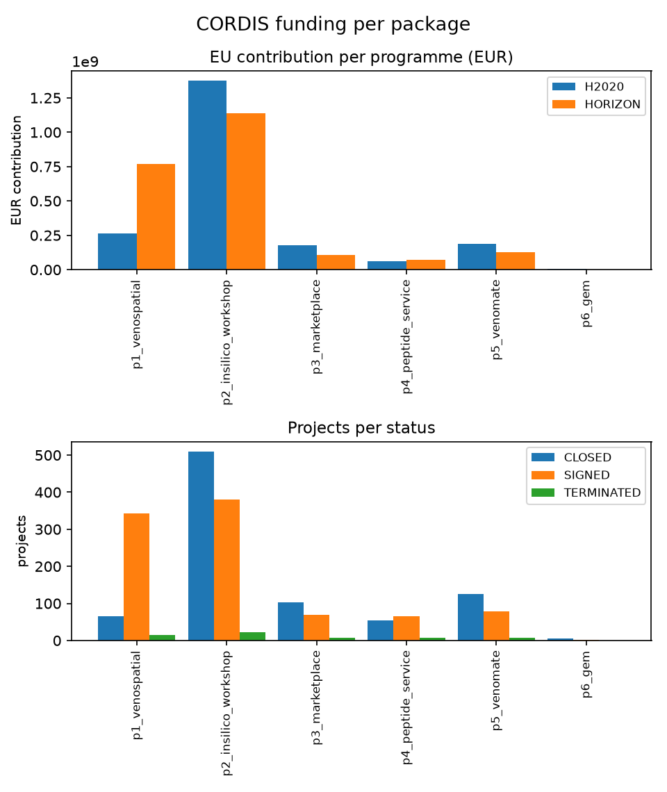
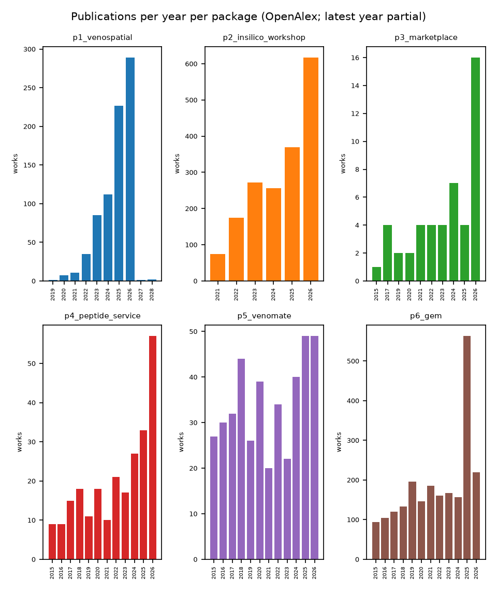
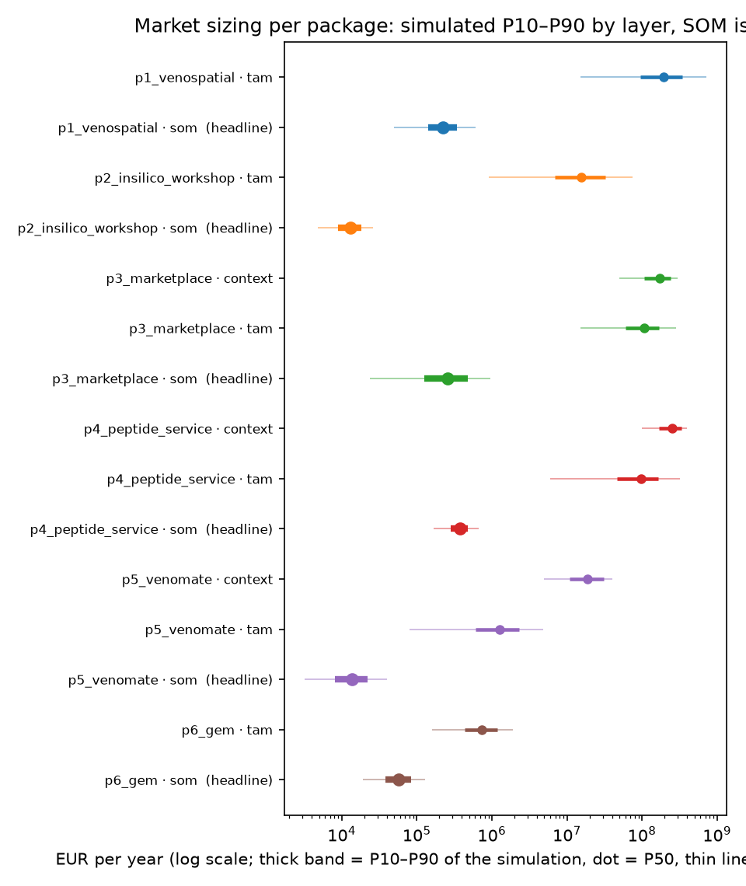

# Market

Every package has a delivery ceiling — what its analyst capacity can earn at
the stated price — and for all six the ceiling is small against the total market view it
sits in. The obtainable share (SOM) is the headline here, named for what it
is: a limit on delivery (capacity × price), not a demand forecast. The total market view (TAM)
is the field the package sells into; each package's ceiling is also shown as
a share of that field. A generic market view (context) exists only where the
evidence supports one, and it is never a headline. The platform's own
revenue — VenoMate profile fees plus the referral on routed work — leads the
Summary and is sized from the same generated source **[LOW CONFIDENCE]**.

This section sizes all six packages.
Each block follows the same six fields: services, target users, value
proposition, delivery, revenue streams, resources. Where the analysis
disagrees with the package description, the block says so.

**Confidence markers.** Revenue bands and delivery ceilings carry inline
labels: **[LOW CONFIDENCE]** for analyst estimates not yet validated,
**[MED CONFIDENCE]** for estimates with some corroboration,
**[HIGH CONFIDENCE]** for validated numbers (rare). Delivery ceilings are
analyst estimates (capacity × price) pending validation through structured
interviews (Annex 2). Until then, treat all marked numbers as provisional.

## How the bands are built

Three layers per package. The SOM layer — the package's **delivery ceiling** —
multiplies an analyst capacity by the stated price. The TAM layer multiplies
a population by a spend rate rebuilt around the actual product — a total market view,
not an addressable claim. The context
layer, where present, is the generic market — background, never a headline.

Each input is a low–middle–high band. These ranges are combined through
simulation to produce probability bands (P10, P50, P90), representing likely
outcomes rather than certainties. The old corner-to-corner product survives
only as an envelope column in the table below — an outer bound, never the
headline. Ranges only, never point estimates.

Capacity estimates are analyst judgements at low confidence, each written
into the assumptions file with its basis and flagged for the validation
interviews (Annex 2, V1–V8). Stated prices come from the package description
and are labelled as such. External anchors are cited at
first use.

## Scope and limitations

The capacities behind every delivery ceiling are analyst estimates. None has
been confirmed by the package leads, and lead confirmation is the first
post-grant step. The package description is fixed input: prices and
plans stated in it are quoted as stated; capacities not stated in it are
analyst estimates, each with its written basis in the stored assumptions
file (Annex 1) and each flagged for the interviews (Annex 2, V1–V6). The
platform referral band rests on one further estimate of the same kind: it
assumes all deliverable package work is routed through the platform — a
ceiling on capture, not an observed share. And a delivery ceiling is a limit
on supply, not on demand: whether buyers arrive at these volumes is a
demand-side question the sized bands cannot answer, and sizing it belongs to
the VMG4 business-model work — a standing limitation of every ceiling shown
here.

> **Validation disclaimer.** All revenue bands and delivery ceilings are analyst estimates, not yet validated. The Validation Plan (Annex 2) provides the mechanism to narrow these bands through structured interviews. Do not treat these numbers as confirmed.

## P1 VENOSPATIAL: Standardized Spatial Multi-Omics Pipeline

**Services.** Online workshops at €500–650 academic and €1,500–1,750 industry
per seat; a training school at €1,000–1,250 academic and €2,250–2,500
industry; consultancy at €125–150/h academic and €250–300/h industry.

**Target users.** Academic labs, pharma and biotech, and AI-bio groups that
want spatial multi-omics without building it (P1's mapped segments).

**Value proposition.** A standardized pipeline, so results move between
institutions and instruments without revalidation.

**Delivery.** Workshops and training cohorts, plus consultancy engagements;
the platform supports and schedules what the network experts deliver.

**Revenue streams.** Seat fees and consultancy day rates.

**Resources.** Network experts in spatial proteomics and transcriptomics;
formal cost modelling is pending, recorded as a validation assumption in
Annex 2.

**Sizing.** The TAM counts institutes that buy spatial multi-omics services
against per-core service outlays — the median designated core and the
heaviest proteomics core in the published facility reports, not an
institute's all-cores total [@ucdavis2015; @utah2025; @genopole2024]:
P10–P90 of the simulation is
{{p1.tam.p10}}–{{p1.tam.p90}} a year **[LOW CONFIDENCE]**. The SOM multiplies deliverable seats
(100–350 a year, analyst estimate, V1) by the stated seat price:
{{p1.som.p10}}–{{p1.som.p90}} a year, mid {{p1.som.p50}} **[LOW CONFIDENCE]**. Both inputs are
weak; read this as an order of magnitude.

**Disagreement with the package description, stated.** The academic workshop price of
€500–650 sits above the €150–550 ceiling observed across nineteen dated
course comparables (Annex 1). Either the price assumes a premium format or
it will meet resistance; the interview (V1) tests it.

**Verdict.** Untested at the stated price; the capacity is the load-bearing
assumption.

## P2 In Silico Workshop: AlphaFold and Molecular Dynamics for Venom Mining

**Services.** Hands-on computational training: structure prediction and
molecular dynamics aimed at venom mining.

**Target users.** Early-career researchers and future spin-off founders.

**Value proposition.** Marketable specialised skills that generalist
bioinformatics courses do not teach.

**Delivery.** Recurring in-person cohorts, sized like EMBO practical courses
(16–25 seats) [@embo2026; @embl2026].

**Revenue streams.** Training fees, paid by learners or their institutions.
Pricing is yet to be defined; the recommended band below is an
analyst construct.

**Resources.** Instructor time and free notebook tooling (ColabFold and the
AlphaFold Server cost nothing to teach on).

**Sizing.** The TAM counts the researcher pool adopting the toolset: 1,763
AlphaFold-attributed works from 1,129 institutions since 2021 (OpenAlex,
5 Oct 2026 pull), scaled to a 3,000–30,000 learner pool at the per-learner
fee band of €300–2,500 anchored on EMBO/EMBL comparables [@embo2026;
@embl2026]: {{p2.tam.p10}}–{{p2.tam.p90}} a year **[LOW CONFIDENCE]**. The SOM takes two cohorts
of 16–24 seats a year (V2) at €150–550 per seat, a band normalised from the
course comparables to a per-day rate and re-priced for a five-day format:
{{p2.som.p10}}–{{p2.som.p90}} a year, mid {{p2.som.p50}} **[LOW CONFIDENCE]**. The Consolidated
bands table carries this delivery ceiling (capacity × price) as a share of its total market view.

**Disagreement with the package description, stated.** The package leaves P2 pricing open;
this band is the analyst recommendation, not a stated price.

**Verdict.** Untested; willingness to pay at the recommended band is exactly
what V2 asks.

## P3 Marketplace for Venom and Peptide Expertise

**Services.** Consultancy, advisory programmes, industry-sponsored
collaborations and grant-funded activities; due diligence for investors, VC
funds and technology-transfer offices.

**Target users.** Labs without in-house AI teams, pharma and biotech
programmes, AI-bio frontier organisations, and investors/TTOs doing
diligence.

**Value proposition.** Vetted expertise matched to real work, brokered end to
end.

**Delivery.** High-touch brokering by the platform; VenoMate (P5) is the
self-service layer that feeds it.

**Revenue streams.** Fees on the four activity types above. The package description states
no commission and no platform fee; whether the platform takes a cut is an
open question for the VMG4 business-model spec. The only platform-level fee
in the package description is VenoMate's 3–5% referral on work routed to any package.

**Resources.** The expert network itself, plus brokering capacity.

**Sizing.** The TAM counts AI-adopter labs without AI teams against
outsourced-expertise spend — the engagements the marketplace actually sells,
not a lab's total tool or staffing budget: 3,000–8,000 labs anchored on ISCB
memberships and conference attendance [@iscb2025; @ismb2025] and core-facility
user groups [@vbcf2024], at €5,000–36,000 per lab per year (one or two
engagements at consultancy day rates) bracketed between core recharges and
CRO day rates [@uthscmemphis2023]: {{p3.tam.p10}}–{{p3.tam.p90}}
a year **[LOW CONFIDENCE]**. The generic AI-in-drug-discovery market (USD 3.05B in 2024
[@insight2025], corroborated by [@gvr2025; @mnm2025]) is context only:
{{p3.context.p10}}–{{p3.context.p90}} a year **[LOW CONFIDENCE]**, never a headline. The SOM
multiplies brokered engagements (12–48 a year, analyst estimate, V3) by a
fee band of €2,000–20,000 built from the same day-rate anchors:
{{p3.som.p10}}–{{p3.som.p90}} a year, mid {{p3.som.p50}} **[LOW CONFIDENCE]**.

**Disagreement with the package description, stated.** The package lists activity types, not
prices; the fee band is an analyst construct from consultancy rates, and the
platform-cut question is deliberately left open.

**Verdict.** The total market view is not the portfolio's widest — P1 and P4 sit
above it — but P3 addresses the broadest field in segment terms; the delivery ceiling is the
binding number, and it is small.

## P4 Peptide Chemistry Service for Disulfide-Rich Peptides

**Services.** Itemised chemistry: solid-phase synthesis (€1,000 academic /
€2,000 industry), purification (€1,500/€3,000), folding (€3,000/€6,000),
report (€1,500/€3,000); totals €7,000 academic, €14,000 industry.

**Target users.** Academic and biotech wet labs ordering disulfide-rich
peptides for research; explicitly not GMP manufacturing.

**Value proposition.** The folding and disulfide chemistry that generic
catalogue suppliers handle poorly.

**Delivery.** Pilot projects first, converting indicative prices into
approved full-cost tariffs; green chemistry per the Sarigiannis principles.

**Revenue streams.** Stage-level fees per synthesis.

**Resources.** Chemistry staff and equipment; benchmark capacity at CRO
price points [@genscript2024; @proteogenix2026; @aapptec2026; @bachem2026].

**Sizing.** The TAM counts labs ordering custom peptides at least once a
year — 3,000–16,000, anchored on core-facility billing and CDMO customer
counts [@utah2025; @vbcf2024; @polypeptide2022] — at €2,000–20,000 per lab
per year from public price lists [@proteogenix2026; @genscript2024;
@aapptec2026]: {{p4.tam.p10}}–{{p4.tam.p90}} a year **[LOW CONFIDENCE]**. The research-lab slice
of the global custom-synthesis market [@valuates2024; @fmi2025; @pmr2025]
is context: {{p4.context.p10}}–{{p4.context.p90}} a year **[LOW CONFIDENCE]**. The SOM takes
24–48 syntheses a year from one RA-scale line (V4) at the stated €7,000–
€14,000 totals: {{p4.som.p10}}–{{p4.som.p90}} a year, mid {{p4.som.p50}} **[LOW CONFIDENCE]**.

**Verdict.** The most defensible deep band: price-list triangulation holds
the spend rate; throughput (V4) is the open question.

## P5 VenoMate: Expertise and Resource Matching

**Services.** Paid profiles — €400 a year for facilities, €2,000 for
industry — referral fees of 3–5% on work routed to any package, and
white-label licensing. Profiles add a badge and analytics,
no ranking advantage; contact runs through introduction requests only.

**Target users.** Venom and toxin research groups, pharma and biotech, and
AI-bio entrants looking for domain access.

**Value proposition.** The field's expertise and resources — people,
samples, instruments, capacity — findable in one place.

**Delivery.** Self-service platform; escalation into P3's brokered work is
the design intent.

**Revenue streams.** Paid profiles, referral fees, white-label licensing;
all accrue to the host institution while the platform has no own revenue
base (flagged for VMG4).

**Resources.** Software build €10k; running cost €7,050 a year fully costed,
€1,050 in-kind.

**Sizing.** The TAM counts venom and toxin wet labs (200–1,200, a reasoned
subset of the publishing institutions in the scientometric record
[@plosntd2016; @animals2022]) at €400–4,000 a year of spend on the
category VenoMate sells — paid profiles at the stated €400 facility and
€2,000 industry prices (up to two industry profiles);
snakebite R&D funding
[@gfinder2024] is kept only as the ceiling sanity check:
{{p5.tam.p10}}–{{p5.tam.p90}} a year **[LOW CONFIDENCE]**. The generic tools-and-services market
is context: {{p5.context.p10}}–{{p5.context.p90}} a year **[LOW CONFIDENCE]**. The SOM is the
package's own year-2 plan: 8–20 paying profiles (V5; the stated plan is 10
facilities plus 3 industry at a blended €400–2,000) gives
{{p5.som.p10}}–{{p5.som.p90}} a year, mid {{p5.som.p50}} **[LOW CONFIDENCE]** — against a fully
costed running cost of €7,050. The planned delivery ceiling (capacity × price) is a four-to-five figure
business, not a platform-scale one.

**Verdict.** The stated economics are the claim to test: profile conversion
(V5) is the whole model.

## P6 Galleria Envenoming Model (G.E.M.) Screening Service

**Services.** Antivenom-efficacy screening using the *Galleria mellonella*
envenoming model at €1,600–2,700 per screen (mid €2,107).
The service is sold as a **pre-screen** during the model's validation
period, not as a replacement for the approved assay: the *Galleria* model is
being validated against the mouse ED50 test by the NC3Rs-funded project
running December 2024–November 2027 [@nc3rs2024gem]. Until that validation
completes, the G.E.M. narrows candidate sera ahead of the regulatory method;
it does not substitute for it.

**Target users.** Academic and antivenom-programme labs screening
candidate sera.

**Value proposition.** Faster and far cheaper than the mouse ED50 route —
the lethality-neutralisation assay that remains the only WHO-approved method
for antivenom potency [@whoantivenom2017]: 2 days against 7–14, and
€1,600–2,700 against €12,000–35,000 per screen. Both comparisons are
package-lead claims — not
published quotes.

**Delivery.** Five person-days per screen: research assistant 2, principal
investigator 2, administration 1.

**Revenue streams.** Per-screen fees.

**Resources.** A colony plus training costs about €1,400
[@galleria2026]; free NC3Rs-funded training workshops are scheduled for 2027.

**Sizing.** The TAM counts labs running or able to adopt the model: 1,273
institutions publish *Galleria* work (OpenAlex, 5 Oct 2026 pull), narrowed
to 100–700 with venom or antivenom programmes, at an annual per-lab
screening spend of one screen a year at the stated price:
{{p6.tam.p10}}–{{p6.tam.p90}} a year **[LOW CONFIDENCE]**. The SOM takes 12–48 screens a
year from a 0.2–0.5 FTE service allocation (V6) at the stated price:
{{p6.som.p10}}–{{p6.som.p90}} a year, mid {{p6.som.p50}} **[LOW CONFIDENCE]**.

**Time and cost claims, with their basis.** On calendar days: 2 days against
7–14 for the mouse ED50 route is a 71–86% time reduction. On
cost: €2,107 against €12,000–35,000 is an 82–94% reduction.
Both are package-lead figures.
The DIY substitute is real: a lab that buys a colony (~€1,400 [@galleria2026])
and attends the free NC3Rs workshops runs the model itself. The service sells
convenience and standardisation, not exclusive capability.

**Verdict.** The unit economics are the strongest in the portfolio; the
demand pool (V6) is the open question.

## Market trends

Four threads sit behind the bands. Each is stated at the strength its evidence
allows; none changes a band.

**EU funding direction.** The funding figure below records project counts and
EU contributions per package under H2020 and Horizon Europe [@cordis].
H2020 covered 2014–2020 while HORIZON runs 2021–2027 and is in progress, so
the two columns are not rate-comparable; nothing here should be read as
"EU funding rose or fell by X%". With that caveat: the spatial-omics lists
move 89 projects ({{p1.cordis.h2020}}) to 332 ({{p1.cordis.horizon}}) across the
programmes; the venom/toxin lists 136 ({{p5.cordis.h2020}}) to 76
({{p5.cordis.horizon}}); the training lists 553 ({{p2.cordis.h2020}}) to 360
({{p2.cordis.horizon}}). Direction, not magnitude.

*Fig. M1. EU contribution and project counts per package, by funding
programme, from the 5 Oct 2026 CORDIS pull. Read with the H2020-versus-HORIZON
window caveat above.*

**Publication growth.** The small-multiples figure shows annual publication
counts per package (OpenAlex, 5 Oct 2026 pull). The venom-peptide corpus
reached 412 works since 2015; the AlphaFold corpus 1,763 since 2021; the
*Galleria* model corpus 2,246 since 2015. The 2026 value in every series is
a partial year, flagged and never used to compute a rate.

*Fig. M2. Publications per year per package, one panel each, from the
OpenAlex pull of 5 Oct 2026; the latest year in every panel is partial.*

**The AI-to-validation bottleneck.** Qualitative claim: AI-native capability
keeps outrunning experimental validation capacity. The scarce resource is
wet-lab data and bench-scale validation, not models (AI side:
[@insight2025]). The trial activity in the Industry section frames the bridge
VMG2 sells, without percentage claims.

**Senolytics and longevity trials.** Qualitative claim, zero numerals:
omics-heavy intervention protocols sit in P1's service space. The registry
queries behind this analysis do not target senolytics, so no count is
attributed to this thread (ClinicalTrials.gov [@ctgov]).

## Consolidated bands

Headline per package is the SOM row: its delivery ceiling.

*Fig. M3. Simulated likely ranges (P10–P90) per package and layer;
the SOM row is the delivery-ceiling headline per package, the thin
whisker is the bound-wise envelope. Values in EUR per year, log scale.*

| Package | Layer | P10 | P50 | P90 | Envelope low | Envelope high | Share of TAM |
| --- | --- | ---: | ---: | ---: | ---: | ---: | ---: |
| P1 VENOSPATIAL | TAM | {{p1.tam.p10}} | {{p1.tam.p50}} | {{p1.tam.p90}} | {{p1.tam.envelope_low}} | {{p1.tam.envelope_high}} | — |
| P1 VENOSPATIAL | **SOM** | {{p1.som.p10}} | {{p1.som.p50}} | {{p1.som.p90}} | {{p1.som.envelope_low}} | {{p1.som.envelope_high}} | {{p1.som.share_of_tam}} |
| P2 In Silico Workshop | TAM | {{p2.tam.p10}} | {{p2.tam.p50}} | {{p2.tam.p90}} | {{p2.tam.envelope_low}} | {{p2.tam.envelope_high}} | — |
| P2 In Silico Workshop | **SOM** | {{p2.som.p10}} | {{p2.som.p50}} | {{p2.som.p90}} | {{p2.som.envelope_low}} | {{p2.som.envelope_high}} | {{p2.som.share_of_tam}} |
| P3 Marketplace | Context | {{p3.context.p10}} | {{p3.context.p50}} | {{p3.context.p90}} | {{p3.context.envelope_low}} | {{p3.context.envelope_high}} | — |
| P3 Marketplace | TAM | {{p3.tam.p10}} | {{p3.tam.p50}} | {{p3.tam.p90}} | {{p3.tam.envelope_low}} | {{p3.tam.envelope_high}} | — |
| P3 Marketplace | **SOM** | {{p3.som.p10}} | {{p3.som.p50}} | {{p3.som.p90}} | {{p3.som.envelope_low}} | {{p3.som.envelope_high}} | {{p3.som.share_of_tam}} |
| P4 Peptide Service | Context | {{p4.context.p10}} | {{p4.context.p50}} | {{p4.context.p90}} | {{p4.context.envelope_low}} | {{p4.context.envelope_high}} | — |
| P4 Peptide Service | TAM | {{p4.tam.p10}} | {{p4.tam.p50}} | {{p4.tam.p90}} | {{p4.tam.envelope_low}} | {{p4.tam.envelope_high}} | — |
| P4 Peptide Service | **SOM** | {{p4.som.p10}} | {{p4.som.p50}} | {{p4.som.p90}} | {{p4.som.envelope_low}} | {{p4.som.envelope_high}} | {{p4.som.share_of_tam}} |
| P5 VenoMate | Context | {{p5.context.p10}} | {{p5.context.p50}} | {{p5.context.p90}} | {{p5.context.envelope_low}} | {{p5.context.envelope_high}} | — |
| P5 VenoMate | TAM | {{p5.tam.p10}} | {{p5.tam.p50}} | {{p5.tam.p90}} | {{p5.tam.envelope_low}} | {{p5.tam.envelope_high}} | — |
| P5 VenoMate | **SOM** | {{p5.som.p10}} | {{p5.som.p50}} | {{p5.som.p90}} | {{p5.som.envelope_low}} | {{p5.som.envelope_high}} | {{p5.som.share_of_tam}} |
| P6 G.E.M. | TAM | {{p6.tam.p10}} | {{p6.tam.p50}} | {{p6.tam.p90}} | {{p6.tam.envelope_low}} | {{p6.tam.envelope_high}} | — |
| P6 G.E.M. | **SOM** | {{p6.som.p10}} | {{p6.som.p50}} | {{p6.som.p90}} | {{p6.som.envelope_low}} | {{p6.som.envelope_high}} | {{p6.som.share_of_tam}} |

All monetary values EUR per year; Share of TAM is a percentage of the package's total market view. Context rows, where absent, are documented rather
than invented (Annex 1). Annex 1 names the generated table behind these rows,
keyed by the machine identifiers the pipeline uses. All revenue bands are analyst estimates pending validation (see Validation Plan, Annex 2).

## Open items

- Learner volume for P2 and engagement throughput for P3 rest on analyst
  judgement; both are interview targets (V2, V3).
- P1's stated academic seat price exceeds the observed course ceiling; the
  interview (V1) tests the ceiling.
- Whether the platform takes a cut of P3 fee streams is unresolved and
  belongs to the VMG4 business-model spec.
- The murine benchmark and the model-adoption comparison for P6 are
  package-lead figures; no
  published quotes were consulted.
