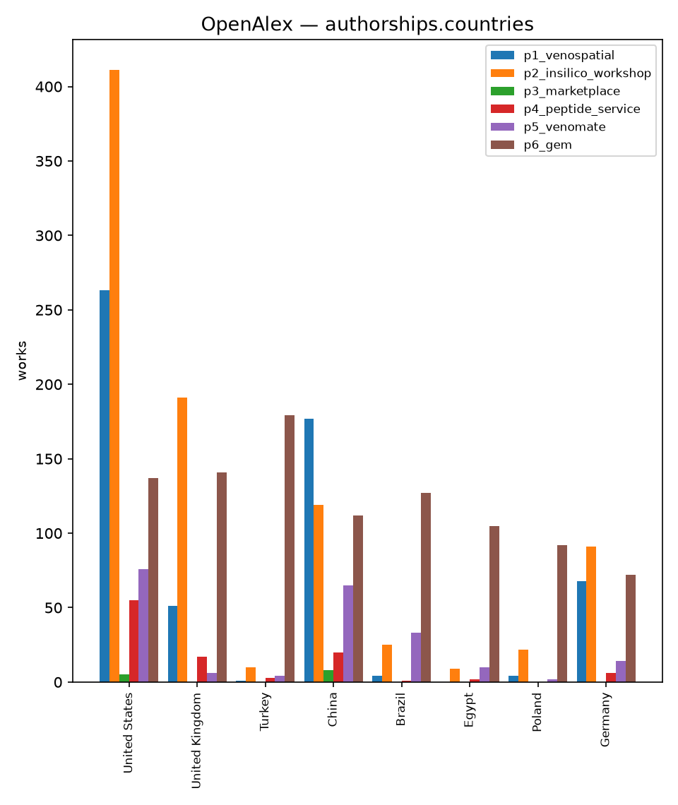
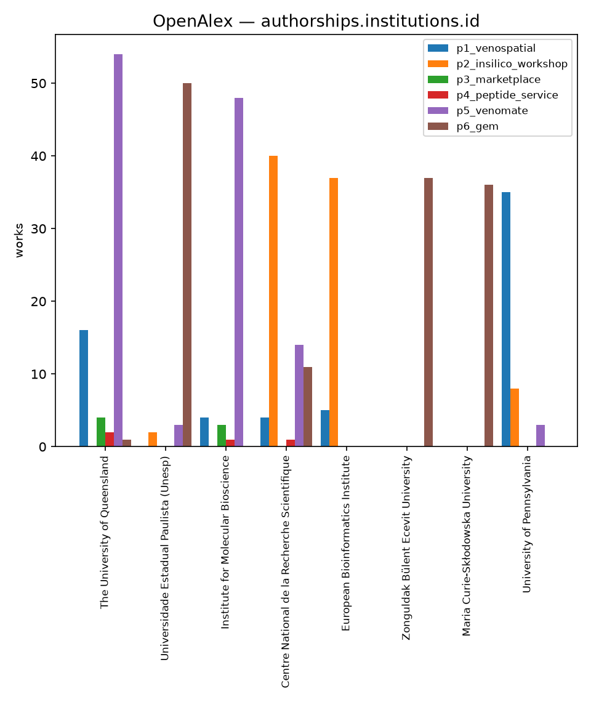
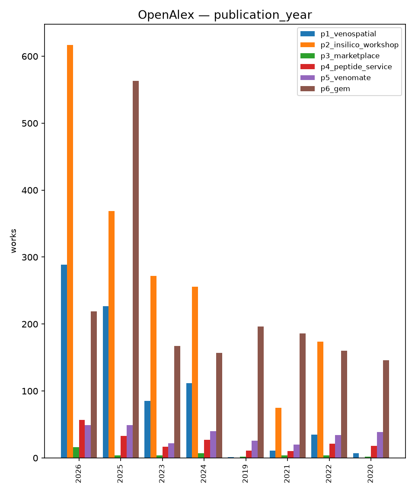
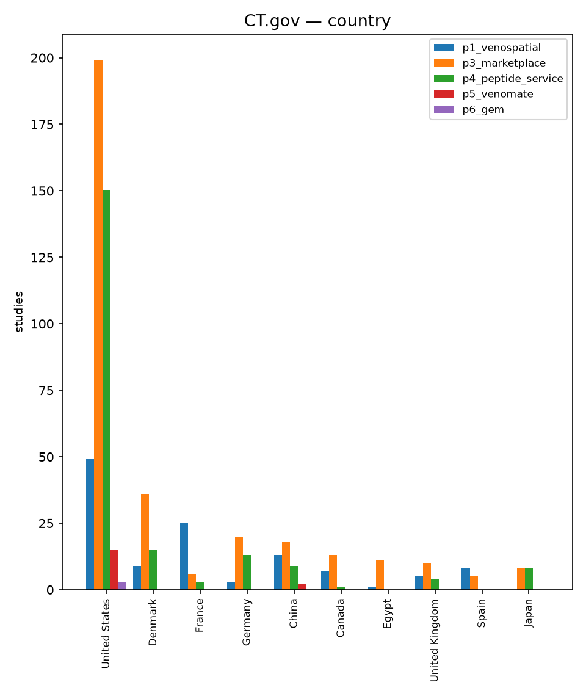
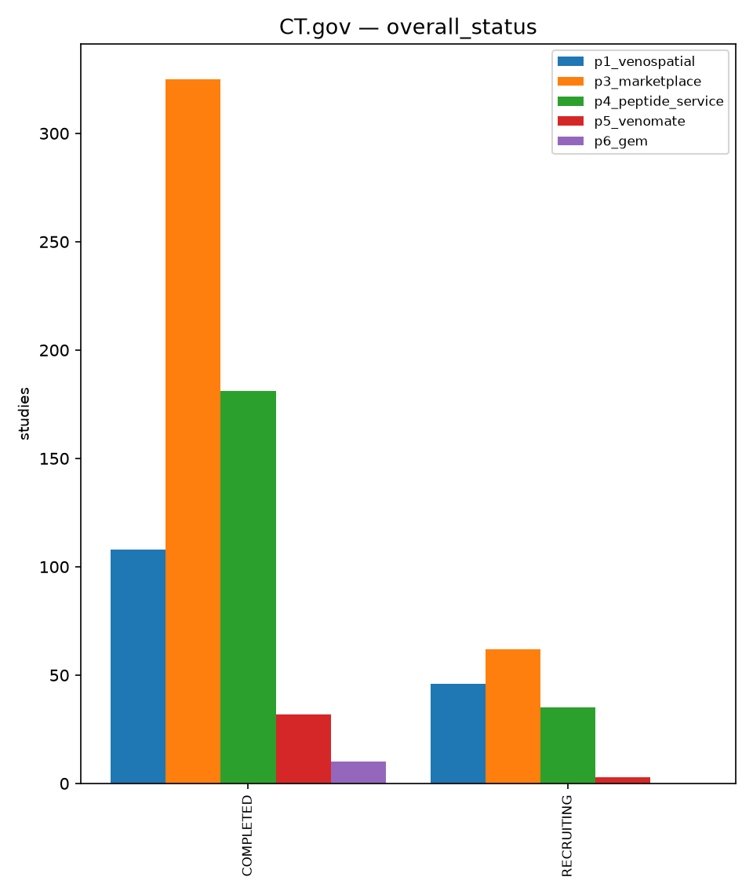
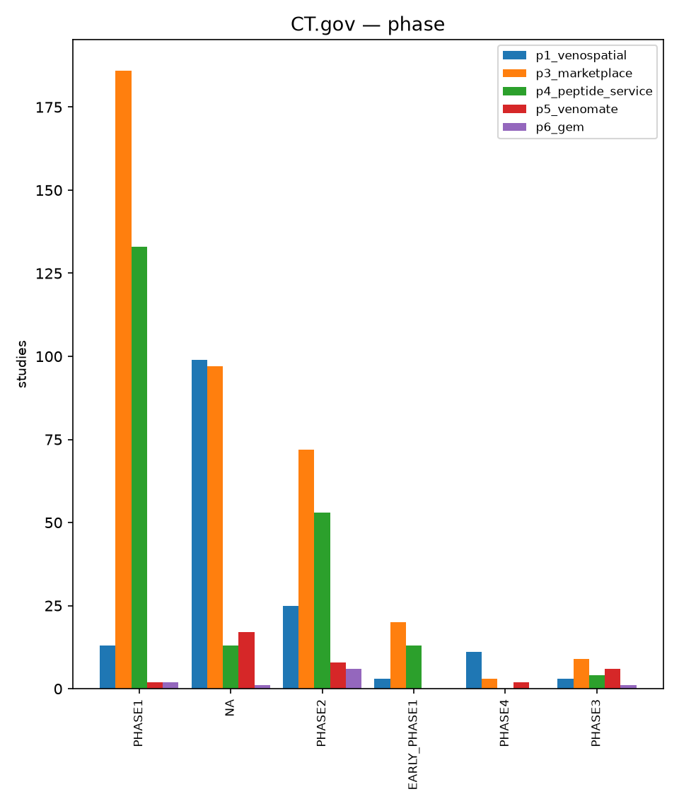
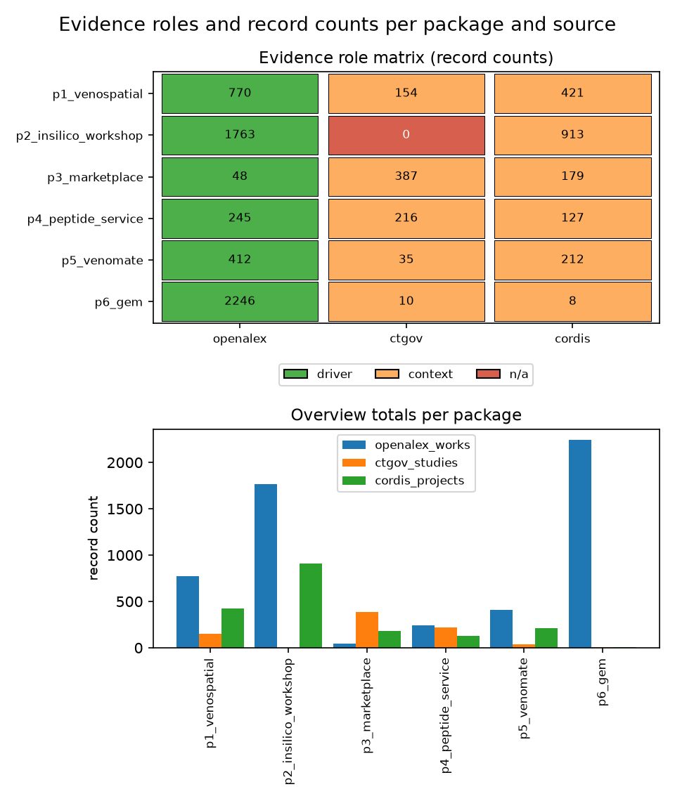

# Industry

The venom-to-therapy chain is fragmented, and fragmentation is the opening.
No single organisation holds it from animal colony to licensed drug; different
specialists work each stage and the hand-offs leak. VENOVATE brokers the
hand-offs in discovery, production and characterisation, plus training across
all stages. Compliance load — access and benefit-sharing under the Nagoya
Protocol, and biosecurity clearance — is the structural barrier on the
physical sourcing stage: it weighs on keeping animal colonies and
collecting venom, not on synthesis from sequence data, brokering,
matching or training [@nagoya].

## The value chain

The pipeline spans six stages, each with distinct capability requirements and
evidence sources:

| Stage | Activity | Evidence source | VENOVATE relevance |
| --- | --- | --- | --- |
| Sourcing | Animal keeping, venom collection | Qualitative (compliance, biosecurity) | Supply-chain access |
| Discovery | Omics, bioinformatics, AI | OpenAlex, CORDIS | P5 VenoMate, P3 Marketplace, P1 VENOSPATIAL |
| Production | Synthetic/recombinant peptides | CORDIS | P4 Peptide Service, P3 Marketplace |
| Characterisation & assays | Validation, pharmacology | CT.gov | P5 VenoMate, P4 Peptide Service |
| Preclinical | Toxicology, PK/PD | CT.gov | Broker position |
| Licensing | Pharma partnerships | Qualitative | Deal-flow filter |

The chain is not vertically integrated in this space. The hand-off points are
where a broker model creates value.

## Where VENOVATE sits

VENOVATE is a broker and aggregator across stages 2–4 plus training. It does
not own animal colonies, run preclinical programmes, or hold licensing deals;
it connects the specialists who do [@maria2026email].

**Discovery (stage 2).** Three packages operate here. P5 VenoMate bundles
venom and toxin proteomics workflows with in-silico capability; its corpus
(412 works since 2015, predominantly academic; OpenAlex, pulled 5 Oct 2026
[@openalex]) evidences the population. P3 Marketplace matches AI-adopting wet
labs without AI teams to outsourced expertise; its literature footprint (48
works on peptide drug discovery) and trial footprint (387 studies — a
context frame; the record overlaps the P4 chemistry count and the two must
not be summed, as the Data evidence section details) show breadth across
countries and therapeutic areas. P1 VENOSPATIAL provides
standardized spatial multi-omics throughput; CORDIS shows 421 matching EU
projects, {{p1.cordis.h2020}} under H2020 and {{p1.cordis.horizon}} under
Horizon Europe [@cordis].

**Production (stage 3).** P4 Peptide Service is the custom-synthesis package
for research labs: 245 works and 127 funded projects behind it. P3
Marketplace also touches production through AI-assisted design and
synthetic-biology advisory.

**Characterisation and assays (stage 4).** VENOVATE brokers between
production outputs and preclinical requirements: P5 carries toxin
pharmacology data and assay design; P4 carries characterisation for
antibody, immunology and proteomics work.

**Training (cross-stage).** P2 In Silico Workshop runs practical courses that
participants carry across all stages; the Customer section maps it to
early-career researchers and future spin-offs.

The overlap between P5 and P3 (three shared segments) is recorded in the
package definitions and resolved by service tier, not market function:
self-service discovery escalating into brokered work. The overlap between P3
and P4 is a real service conflict; the routing rule is stated in the Summary
and the Competitive section identically.

## Five-forces assessment

Nagoya compliance and biosecurity clearance weigh on one stage of the
chain, not every force: they are legal requirements on physical sourcing —
access to genetic resources and the organisms that produce them — and they
do not restrict the lines that synthesise from sequence data, broker, match
or train.

### Threat of new entrants: Low on sourcing, higher on the service lines

Entry to the physical sourcing stage needs three things most organisations
cannot assemble: legally compliant access to animal genetic resources
under the Nagoya Protocol (prior informed consent and mutually agreed
terms, tracked through the Access and Benefit-Sharing Clearing-House)
[@nagoya]; biosecurity clearance for venomous organisms; and specialised
animal-keeping infrastructure. The WHO records that "very few countries
have capacity to produce snake venoms of adequate quality for antivenom
manufacture" [@who2025]. Whether venom proteomes and sequence data drawn
from sourced animals trigger benefit-sharing obligations is an open legal
question on the sourcing side; it raises the bar there, not elsewhere.

The service lines tell the opposite story. Brokering, matching, training
and synthesis from sequence data need no colonies and no venom
collections: the Competitive section's own inventory records dense fields
of expert networks, freelance scientist platforms, training providers and
peptide synthesis services, with free or low-cost substitutes alongside on
every one of them. The threat of new entrants on those lines is moderate
to high; what keeps casual entrants out of them is credibility and routed
demand, not permits.

### Bargaining power of suppliers: Moderate

The supplier base — colonies, venom-collection expertise, specialised
reagents — is concentrated. Few countries maintain high-quality venom
production, and venom composition varies geographically, so no single
supplier serves all needs. The scientometric record shows publishing capacity
itself is concentrated: 3,922 institutions across the 2016 analysis window
[@plosntd2016], and top-ten institutions holding 39.7% of the 1933–2022
snake-venom corpus [@animals2022].

### Bargaining power of buyers: Moderate

Buyer power splits. Academic labs are grant-constrained and can switch
suppliers or defer AI investment. Pharma and biotech are programme-driven and
less price-sensitive when a service de-risks a milestone, but can internalise
capability at scale. The trial record (216 studies on peptide chemistry, 387
on peptide expertise; CT.gov, pulled 5 Oct 2026 [@ctgov]) is ecosystem
context, never evidence of commercial demand: the records overlap completely
— all 216 chemistry studies also appear in the expertise record — so the
two counts must not be summed.

### Threat of substitutes: Moderate

The substitute for a broker is vertical integration. Large pharma can build
venom research, synthesis and AI capability in-house; open tools reduce
friction (the OpenAlex corpus itself is partly open access [@openalex]); and
EU-funded consortia often bundle discovery, production and characterisation
internally, bypassing the broker layer [@cordis]. The funding and publication
footprints show both the opportunity and the integration threat.

### Competitive rivalry: Emerging

The specialist market is fragmented: niche synthesists, venom proteomics labs
and AI-bio consultancies, no dominant platform. Rivalry is the Competitive
section's subject; the structural observation here is that fragmentation
creates the broker opportunity and consolidation would reduce it.

## Data evidence

The figures below bound the structural claims: the landscape of publication
activity, and the trial-activity frames across the value chain. Record counts
and their declared roles per package and source are tabulated in the Methods
annex; the sparse trial cells (P5's 35 studies, P6's 10) are visible there.
The registry records overlap across packages: nine of P6's 10 studies also
sit in P5's 35, and P4's entire record sits inside P3's — every
trial count in this section is context on shared records, never evidence of
commercial demand, and the counts must not be summed.

*Fig. I1. Publication counts per package by country (OpenAlex, pulled 5 Oct
2026).*

*Fig. I2. Publication counts per package by institution (OpenAlex, pulled 5
Oct 2026).*

*Fig. I3. Publication counts per package by year (OpenAlex, pulled 5 Oct
2026); the latest year in every series is partial and never used to compute
a rate.*

*Fig. I4. Trial activity per package by country (CT.gov, pulled 5 Oct 2026).*

*Fig. I5. Trial activity per package by status (CT.gov, pulled 5 Oct 2026):
P3 shows 325 completed and 62 recruiting, P4 181 completed and 35
recruiting. The two panels frame shared records — P4's chemistry query is a
subset of P3's expertise query — so they are context views over overlapping
studies, not additive pipelines.*

*Fig. I6. Trial activity per package by phase (CT.gov, pulled 5 Oct 2026).*

*Fig. A1. Evidence roles and record counts per package and source, from the 5 Oct 2026 pull.*

## Open items

- Frontier deal-flow claims stay directional: the public target register is
  category-level (Customer section).
- P2's willingness to pay rests on comparables untested against buyer
  behaviour (Market section, V2).
- Rivalry here is structural only; named-competitor evidence lives in the
  Competitive section.
- The G-FINDER 2024 report URL was unresolvable at citation time; it is
  cited by name and date [@gfinder2024].
